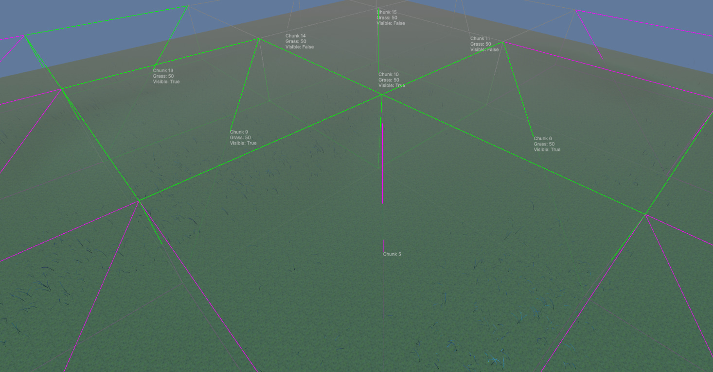

<div align="center">

# Unity-Grass — Procedural Grass (Ghost of Tsushima style)


GPU grass rendering experiment: an HLSL **compute shader** scatters blades across the terrain,
a graphics shader draws them — **millions of blades** at interactive framerate.
An implementation of the approach from the famous talk
[Procedural Grass in 'Ghost of Tsushima'](https://www.youtube.com/watch?v=Ibe1JBF5i5Y).

https://github.com/user-attachments/assets/b5731855-1400-4dbc-8668-bc157d50b608

</div>

---

## Key features

- **Blade shape** from cubic Bézier curves.
- **Wind animation** — scrolling 2D Perlin noise fed into a sin-based function modulates blade parameters.
- **Clumping** — Voronoi clumps share parameters for a non-uniform, natural look.
- **Lighting** — Phong shading, gloss map, fake ambient occlusion based on blade length.
- **Color** — gradient along the blade + clump color + albedo texture.
- **Heightmap terrain** — blades spawn on the heightmap surface, mask-based vegetation spawning (Terrain mask controls where grass grows / gets cut).
- **GPU instancing** — millions of blades in one draw path.
- **Frustum culling** — blades outside the camera frustum are skipped.
- **Distance culling** — fewer blades far away, with a smooth near↔far transition.
- **Chunking** — chunk-based rejection on the CPU.
- **URP** — works on the Universal Render Pipeline.



## How it works

```
compute shader  →  scatter & animate blade instances (GPU, per-chunk)
        ↓
graphics shader →  build each blade from a cubic Bézier, shade, light, output
        ↓
CPU per frame   →  chunk visibility (frustum + distance), constant buffer updates
```

Blades are never touched individually on the CPU — the CPU only decides which **chunks** are visible; everything else (scattering, wind, deformation) happens in shaders.

## Requirements

- Unity `6000.0.47f1` (see `ProjectSettings/ProjectVersion.txt`), URP
- A GPU with reasonable compute shader support

## Getting started

```bash
git clone https://github.com/blakSou1/Unity-Grass.git
```

1. Open the project in **Unity 6000.0.47f1** (let it import URP packages).
2. Open the demo scene and press **Play**.
3. Tweak grass parameters (density, wind, colors, clumping) on the grass settings asset — the look is fully parameter-driven.

> **Tip:** use a number of chunks that is a multiple of 4.

## Tuning & known bugs

- **Buffer overflow** — with a very large amount of grass on screen the instance buffer can overflow and some grass is dropped from the render.
- **Terrain must be square** — terrain width and height must be identical; the heightmap is not stretched correctly and only works for square terrains.
- **Chunk count** — recommended to use a chunk number that is a multiple of 4.

## To-do

- [ ] LODing
- [ ] Transparency fade for distance-culled grass
- [ ] Receive shadows from the shadow map
- [ ] Cast shadows onto terrain (fake it Tsushima-style — don't include grass in the shadow pass)
- [ ] Grass deforms based on player movement
- [ ] Occlusion culling
- [ ] Spend single-blade verts on multiple blades when grass is short (as Tsushima does)

https://github.com/user-attachments/assets/c8a54dfd-60e2-4c74-be4d-979a40ab2769

## Performance notes

The grass is quite performant, though crucial optimizations are still to come (LOD first).
Look and movement are highly customizable via parameters.

## Credits & resources

Techniques learned from (non-exhaustive):

- [Procedural Grass in 'Ghost of Tsushima'](https://www.youtube.com/watch?v=Ibe1JBF5i5Y)
- [Acerola — How Do Games Render So Much Grass?](https://www.youtube.com/watch?v=Y0Ko0kvwfgA)
- [GarrettGunnell/Grass](https://github.com/GarrettGunnell/Grass)
- [harlan0103/Grass-Rendering-in-Modern-Game-Engine](https://github.com/harlan0103/Grass-Rendering-in-Modern-Game-Engine)
- [cainrademan/Unity-Grass](https://github.com/cainrademan/Unity-Grass)
- [Youssef-Afella/UnityURP-InfiniteGrass](https://github.com/Youssef-Afella/UnityURP-InfiniteGrass)
- [EricHu33/UnityGrassIndirectRenderingExample](https://github.com/EricHu33/UnityGrassIndirectRenderingExample)

## License

[MIT](./LICENSE)
